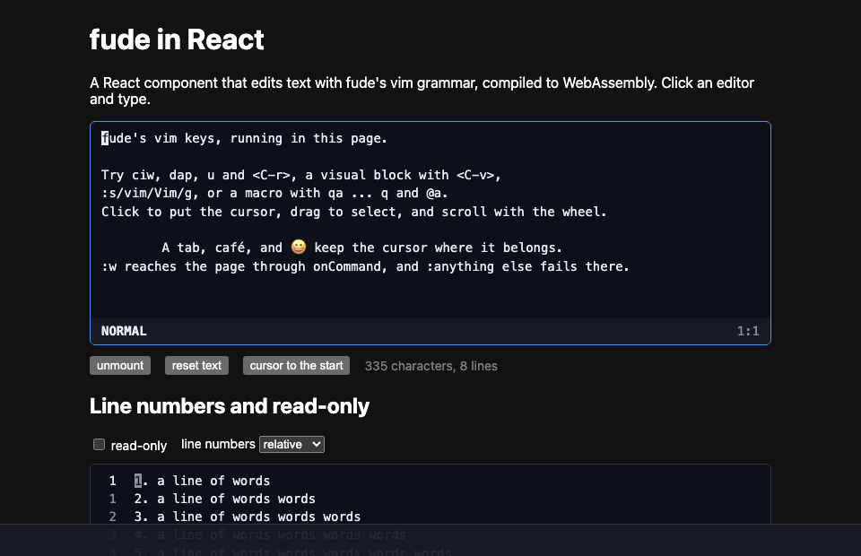

# fude-react

A React component that edits text with [fude](https://github.com/y3owk1n/fude)'s vim grammar, compiled to WebAssembly. It runs in the page, with no server.



## Run it

```sh
oku sync && oku allow
just dev
```

`just dev` builds the grammar into `src/`, installs the npm packages and serves the demo page.

| Recipe | What it does |
|---|---|
| `just wasm` | Build `src/fude.wasm` with tinygo, and copy the `wasm_exec.js` of the same tinygo |
| `just dev` | Serve the demo page with reloads |
| `just build` | Build the demo page into `dist/` |
| `just fmt` | Format the Go and the page |
| `just check` | Formatting, `go vet`, biome and the tests |
| `just e2e <chrome>` | Check the built page in the headless Chrome or Chromium at `<chrome>` |
| `just demo <chrome>` | Record `demos/fude-react.gif` with the headless Chrome or Chromium at `<chrome>` |

## Use the component

```jsx
const editor = useRef(null);

<FudeEditor
	ref={editor}
	defaultValue="hello world"
	rows={12}
	lineNumbers="relative"
	onChange={(text) => save(text)}
	onCommand={(line) => {
		if (line === "w") return save();
		throw new Error(`unknown command: ${line}`);
	}}
/>;
```

### Props

- `defaultValue` is the text it starts with. The editor owns its text once it mounts, which keeps its undo history. Give it a new `key` to start over.
- `rows` is how many lines show. `<C-d>`, `zz` and the rest scroll by it.
- `onChange(text)` gets the text after each change.
- `onCommand(line)` gets the ex lines the grammar leaves to the page, without the colon, such as `w` for `:w`.
  - A string it returns shows in the status line.
  - An error it throws shows as an error, and stops a macro or `:g` that ran the line.
  - Without `onCommand`, such a line fails as an unknown command.
- `readOnly` keeps keys from changing the text. Motions, search and yanks still work.
- `lineNumbers` is `true` for line numbers, or `"relative"` for numbers counted from the cursor's line.
- `highlight(view)` colours the rows in view. See [Syntax highlighting](#syntax-highlighting).
- `autoFocus` focuses the editor once it loads.
- `className` goes on the editor's outer element, beside `fude`.
- `aria-label` names the editor for screen readers, `editor` by default.
- `wasmUrl` is where the grammar loads from. The first editor on the page loads it, and every other editor shares it.

### Ref

- `focus()` and `blur()`.
- `getValue()` returns the text.
- `setValue(text)` replaces the text as one change, which `u` takes back. It works in a read-only editor, and it calls `onChange`.
- `type(keys)` types keys in vim notation, such as `"gg0"` or `"<Esc>"`.

A call made before the grammar loads, or from inside `onCommand`, runs once the editor is ready.

### Mouse and keyboard

- A click puts the cursor on the character under it. In insert mode it puts the cursor in the gap nearest it.
- A drag selects in visual mode, and the wheel scrolls the view.
- Keys go to a hidden text area, so input methods and dead keys work, and paste uses the system's keys.
- `"+y` and `"*y` copy to the system clipboard. `"+p` puts what this page last copied or pasted, until the window loses focus.

### Syntax highlighting

`highlight` takes the view and returns, for each row in it, the runs to colour as `[from, to, className]`. Columns count UTF-16 units, as JavaScript strings do.

- `view.editor` stays the same object while one editor lives. It changes when the editor remounts, and the text is then new.
- `view.version` changes when the text does.
- `view.text()` returns the whole text. Call it only when the version changes.
- `view.top` is the line of the first row, from 0, and `view.rows` is the text of each row.

The component calls it again when the version, the top or the number of rows changes, and when `highlight` itself changes. An error it throws goes to the console, and the rows show without colours. A colour shows under the selection and the cursor.

`src/treeSitter.js` is one for the demo, on [web-tree-sitter](https://github.com/tree-sitter/tree-sitter/tree/master/lib/binding_web):

```jsx
import grammar from "tree-sitter-javascript/tree-sitter-javascript.wasm?url";
import highlights from "tree-sitter-javascript/queries/highlights.scm?raw";
import { useTreeSitter } from "./treeSitter.js";

const highlight = useTreeSitter(grammar, highlights);
<FudeEditor defaultValue={code} highlight={highlight} />;
```

- It parses each version once. It tells tree-sitter which span changed, so the parse reuses the tree from the version before.
- A capture such as `@function.method` becomes the class `hl-function-method`. The page styles those classes, as `index.html` does.
- It keeps one tree, so give each editor on the page its own. One editor that remounts can keep it.
- Any grammar built to wasm works, with its highlights query.

### Theme

Set these custom properties on `.fude`, or on a class you pass in:

| Property | What it colours |
|---|---|
| `--fg`, `--bg` | The text and its background |
| `--dim` | Line numbers, the status line's notes, an unfocused cursor |
| `--border`, `--focus` | The border, and the border while focused |
| `--cursor`, `--cursor-fg` | The cursor and the character under it |
| `--cursors` | The other cursors |
| `--selection`, `--match`, `--flash` | A selection, the match a search goes to, a yank or put |
| `--error` | An error in the status line |
| `--status` | The status line's background |
| `--font`, `--line` | The font, and the height of a line |

Dark values apply under `prefers-color-scheme: dark`. The component's inner classes all start with `fude-`, so a page rule such as `.line` or `.bar` does not match them.

## How it works

- `editor.go` is the grammar's host. It keeps the text in a buffer from fude's `core` module, which gives it undo, redo and marks that move with edits.
- `main.go` sets `fude.create` for the page. Each editor gets its own handle. A panic inside one shows as that editor's error and goes to the console, and the page keeps running.
- Each call returns the state as JSON: the rows in view, with their selection, matches and cursors, and the status line. Columns count UTF-16 units, as JavaScript strings do.
- A key that moves costs the same on a long text as on a short one. A change also hands the whole text to `onChange` and `highlight` when they are set. On 20,000 lines an edit still paints within a frame.
- `src/FudeEditor.jsx` turns keys and the mouse into calls and draws the state. `src/keys.js` maps keys as fude's own frontends do.
- `test/e2e.mjs` drives the demo page in headless Chrome and checks keys, input methods, paste, the mouse, the wheel, commands, the clipboard, read-only, remounts, the ref and highlighting.
- `.npmrc` turns off install scripts. The demo needs only the grammar's wasm and query, not the node addon `tree-sitter-javascript` builds.

## Limits

- The grammar weighs 2 MB, 0.7 MB gzipped. The tree-sitter runtime and the JavaScript grammar in the demo add 0.6 MB, 0.14 MB gzipped.
- `wasm_exec.js` gives the page a stub `process` when it has none, because go's runtime reads it. The component gives that stub an empty `versions`, so a library that checks `process.versions.node` sees a browser.
- No windows, files, plugins or line wrapping. Those belong to the editor, not the grammar.
- The browser reads the clipboard only asynchronously, so `"+p` knows only what this page copied or pasted.
- Tab types a tab or jumps, as in vim, so the keyboard does not leave the editor with Tab.
- On Linux and Windows the browser keeps some chords, such as `<C-w>` and `<C-t>`.
- The checks run only in headless Chromium. Safari, Firefox, a real Cmd+V and phone keyboards are untested. Safari finds the character under the mouse with `caretRangeFromPoint`, and that code has never run.
- A drag does not scroll the view when it leaves the editor.

## License

[MIT](LICENSE)
